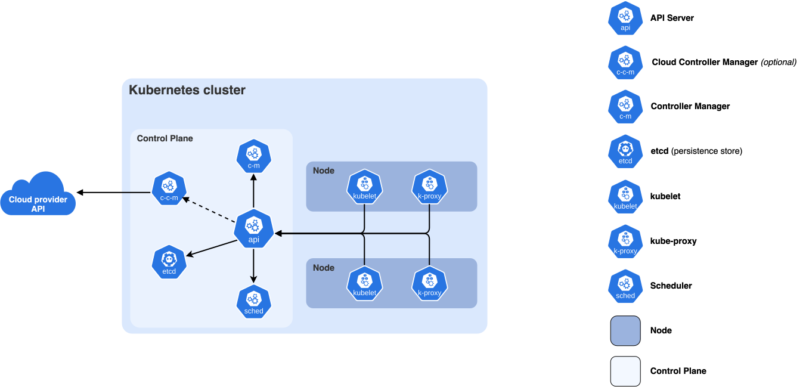

+++
title = "Kubernetes 1/2 : namespace, Deployment, Service"
weight = 2
draft = false
+++

Tout ce qui suit est fondé sur la documentation officielle **Kubernetes**, en français —
[kubernetes.io/fr/docs/concepts](https://kubernetes.io/fr/docs/concepts/) — appliquée à
l'application legacy `petclinic` déjà conteneurisée à la semaine 7 (image publiée sur GHCR, port
`9966`).

---

## 1️⃣ D'abord le problème : pourquoi un conteneur seul ne suffit pas

À la semaine 7, vous avez appris à empaqueter `petclinic` dans une image Docker et à la démarrer
avec `docker run -d -p 9966:9966 ...`. Puis, à la page précédente
([Azure Container Instances]({})), vous l'avez
déployée dans le nuage avec `az container create` — et vous avez vous-même constaté deux
problèmes : son adresse publique peut changer lors d'un redémarrage, et rien ne permet d'en faire
tourner automatiquement plusieurs copies. Généralisons : imaginez que cette application soit un
vrai site, utilisé jour et nuit par de vrais clients :

- **À 3 h du matin, le conteneur plante.** ACI le relance, mais avec une nouvelle adresse — tout
  ce qui pointait vers l'ancienne est cassé, et personne n'a été prévenu.
- **Le trafic est multiplié par dix.** Un seul conteneur n'arrive plus à répondre, et ACI n'a
  aucun mécanisme pour en démarrer d'autres automatiquement.
- **La machine qui héberge le conteneur tombe en panne.** Si tout roulait sur cette seule machine,
  tout disparaît avec elle.

Aucun de ces trois problèmes n'est un problème de code — `petclinic` lui-même est correct. Le
problème, c'est tout ce qui doit entourer une application pour qu'elle survive en continu, sans
personne à côté pour la surveiller. C'est exactement ce que Kubernetes ajoute à un simple moteur de
conteneurs :

> « Kubernetes vous fournit un cadre pour exécuter des systèmes distribués de manière résiliente.
> Il prend en charge la mise à l'échelle et le basculement pour votre application, fournit des
> modèles de déploiement, et plus encore. »
> — [Kubernetes — Vue d'ensemble](https://kubernetes.io/fr/docs/concepts/overview/)

Deux de ces capacités seront centrales dans cette page : la répartition de charge (le travail du
**Service**, section 4️⃣) et l'auto-guérison, c'est-à-dire le redémarrage automatique (le travail du
**Deployment**, section 3️⃣). Mais avant d'y arriver, il faut d'abord comprendre *où*, concrètement,
tout cela se passe : sur un **cluster**.

### Qu'est-ce qu'un cluster, au juste?

Un **cluster** — le mot anglais signifie « grappe » ou « groupe » — est un ensemble de machines
reliées entre elles et gérées comme si c'était une seule grosse machine. La documentation
officielle le résume en une phrase, puis détaille aussitôt ce que ce « plan de contrôle » et ces
« nœuds » recouvrent réellement — ce que les deux prochaines sous-sections définissent à leur
tour :

> « Un cluster Kubernetes est composé d'un plan de contrôle et d'un ou plusieurs nœuds de
> travail. »
> — [Kubernetes — Composants de Kubernetes](https://kubernetes.io/fr/docs/concepts/overview/components/)

Quand une machine fait partie d'un cluster, on ne l'appelle plus « machine », mais un **nœud**
(*node*) — comme un nœud dans un filet, un point du réseau qui tient avec les autres :


> « Kubernetes exécute votre charge de travail en plaçant des conteneurs dans des Pods pour
> s'exécuter sur des _nœuds_. Un nœud peut être une machine virtuelle ou physique, selon le
> cluster. [...] Typiquement, vous avez plusieurs nœuds dans un cluster; dans un environnement
> d'apprentissage ou limité en ressources, vous pourriez n'avoir qu'un seul nœud. »
> — [Kubernetes — Nœuds](https://kubernetes.io/fr/docs/concepts/architecture/nodes/)

> 🍽️ **Analogie** : un conteneur seul, c'est un cuisinier seul dans sa cuisine — tant qu'il est en
> forme et qu'il y a trois clients, tout va bien. Un cluster, c'est la brigade d'un vrai
> restaurant : plusieurs cuisiniers (des **nœuds**) qui se partagent le travail. Si l'un tombe
> malade, les autres continuent le service. Si la salle se remplit, on appelle du renfort. Le
> client, lui, ne voit jamais la cuisine : il voit un seul restaurant, avec une seule porte
> d'entrée. C'est exactement la promesse d'un cluster : plusieurs machines derrière, mais une
> seule chose à gérer devant.

Dans ce cours, votre cluster personnel sera petit — un seul nœud suffit pour apprendre, et il
coûte moins cher sur votre crédit étudiant (voir
[Azure Kubernetes Service (AKS)]({})). Le
principe reste identique à celui des entreprises qui en ont des centaines.

### Mais qui décide quoi tourne où? Le plan de contrôle

Avoir plusieurs machines ne règle rien, à elles seules : il faut quelqu'un qui décide quel nœud
fait rouler quel conteneur, qui surveille en permanence, et qui réagit quand quelque chose casse.
Un cluster se divise donc en deux grandes parties : le **plan de contrôle** (*control plane*), qui
décide, et les **nœuds**, qui exécutent. Voici comment la documentation officielle illustre cette
séparation :



> — [Kubernetes — Composants de Kubernetes](https://kubernetes.io/fr/docs/concepts/overview/components/),
> image sous licence [CC BY 4.0](https://github.com/kubernetes/website#creative-commons)

Le plan de contrôle **« gère l'état global du cluster »**. En clair : c'est lui qui prend
toutes les décisions (quoi lancer, où, et que faire si ça casse), mais qui ne fait jamais
tourner vos conteneurs lui-même. Il se compose de cinq pièces :

| Composant | En une phrase simple | Rôle détaillé (traduit de la documentation officielle) |
|---|---|---|
| **kube-apiserver** | La porte d'entrée du cluster | « Le serveur principal qui expose l'API HTTP de Kubernetes » : c'est le **seul** point de contact pour `kubectl` (et pour tous les autres composants ci-dessous) — rien n'entre ou ne sort du cluster sans passer par lui |
| **etcd** | La mémoire du cluster | « Un magasin de clés-valeurs cohérent et hautement disponible pour toutes les données du serveur API » : il conserve l'état désiré et l'état actuel de **tout** (Deployments, Services, Secrets, etc.) — si `etcd` perd ses données, le cluster oublie tout ce qu'il devait faire tourner |
| **kube-scheduler** | Le répartiteur de tâches | « Recherche les Pods qui ne sont pas encore liés à un nœud et attribue chaque Pod à un nœud approprié » : chaque fois qu'un nouveau Pod doit démarrer, c'est lui qui choisit *sur quel nœud* (selon les ressources disponibles — CPU, mémoire) |
| **kube-controller-manager** | Le surveillant qui corrige les écarts | « Exécute des contrôleurs pour mettre en œuvre le comportement de l'API Kubernetes » : en continu, il compare l'état réel à l'état désiré (ex. « il devrait y avoir `replicas: 2` Pods », section 3️⃣) et relance automatiquement un Pod si l'un d'eux meurt |
| **cloud-controller-manager** *(optionnel)* | Le pont vers le fournisseur cloud | « S'intègre aux fournisseurs de cloud sous-jacents » : ici Azure — c'est ce composant qui demande concrètement à Azure de créer l'adresse IP publique d'un Service `LoadBalancer` (section 4️⃣) |

— [Kubernetes — Composants de Kubernetes](https://kubernetes.io/fr/docs/concepts/overview/components/)

Chaque **nœud**, de son côté, ne décide rien — il **exécute** ce que le plan de contrôle lui
confie, grâce à trois logiciels installés dessus :

| Composant | En une phrase simple | Rôle détaillé (traduit de la documentation officielle) |
|---|---|---|
| **kubelet** | L'agent qui fait réellement démarrer vos conteneurs | « Veille à ce que les Pods s'exécutent, y compris leurs conteneurs » : il tourne sur chaque nœud, reçoit les instructions du plan de contrôle (via le kube-apiserver) et s'assure que les conteneurs demandés sont bel et bien en vie sur *sa* machine |
| **kube-proxy** *(optionnel)* | Le gestionnaire du réseau local | « Maintient les règles réseau sur les nœuds pour mettre en œuvre les Services » : c'est lui qui fait en sorte qu'un appel vers un Service (section 4️⃣) soit redirigé vers le bon Pod, même si ce Pod est sur un autre nœud |
| **Runtime de conteneur** | Le moteur qui exécute vos images | Le logiciel qui télécharge vos images (ex. depuis le GHCR, section 4️⃣ de la page AKS) et lance concrètement les conteneurs — par exemple `containerd` |

— [Kubernetes — Composants de Kubernetes](https://kubernetes.io/fr/docs/concepts/overview/components/)


> 🍽️ **Analogie** (suite) : dans le restaurant, le **plan de contrôle**, c'est le chef qui tient
> les commandes, répartit les plats entre les cuisiniers et vérifie que rien ne brûle — mais qui
> ne cuisine pas lui-même. Les **nœuds** sont les cuisiniers.

### Déclarer un état désiré, plutôt que donner des ordres un par un

Vous pourriez imaginer piloter un cluster avec des commandes, une par une : « démarre ceci »,
« arrête cela ». Ce n'est **pas** comme ça que Kubernetes fonctionne.

> 🌡️ **Analogie** : un thermostat ne vous demande pas d'allumer et d'éteindre le chauffage chaque
> minute. Vous affichez la température souhaitée — 21 degrés — et il compare sans arrêt la
> température réelle à la cible, puis corrige tout seul. Kubernetes fait la même chose avec vos
> conteneurs : vous affichez « je veux 2 copies de `petclinic` », et il compare sans arrêt la
> réalité à cette cible, puis corrige tout seul.

En résumé : vous décrivez un **état désiré** (« je veux 2 copies de `petclinic` qui tournent »)
dans un fichier YAML envoyé au plan de contrôle via `kubectl`, et le plan de contrôle se charge, en
continu, de faire correspondre l'état réel du cluster à cet état désiré — y compris en relançant
des conteneurs disparus. On appelle cette surveillance permanente la **réconciliation**, et cette
façon de travailler — décrire le résultat voulu plutôt que les gestes un par un — le **mode
déclaratif**. C'est cette boucle de contrôle continue, et non un script exécuté une seule fois,
qui distingue fondamentalement Kubernetes d'un `docker run` manuel.

> 💡 Dans ce cours, vous n'installerez jamais vous-mêmes un plan de contrôle : votre cluster
> [Azure Kubernetes Service]({}) est déjà prêt.
> Votre travail se limite à y envoyer des manifestes YAML avec `kubectl apply`.

---

## 2️⃣ `namespace` : cloisonner les ressources d'un cluster

Un cluster Kubernetes est souvent **partagé** entre plusieurs équipes ou projets — dans une
entreprise, le même cluster héberge fréquemment plusieurs applications, parfois de plusieurs
équipes. Le mécanisme qui permet ce partage, sans que les ressources des uns et des autres se
mélangent, s'appelle le **namespace** :

> « Dans Kubernetes, les _namespaces_ (espaces de nommage) fournissent un mécanisme pour isoler
> des groupes de ressources au sein d'un seul cluster. Les noms des ressources doivent être
> uniques dans un namespace, mais pas à travers les namespaces. »
> — [Kubernetes — Namespaces](https://kubernetes.io/fr/docs/concepts/overview/working-with-objects/namespaces/)

> « Les _Namespaces_ sont destinés à être utilisés dans des environnements avec de nombreux
> utilisateurs répartis sur plusieurs équipes ou projets. [...] Les namespaces sont un moyen de
> diviser les ressources du cluster entre plusieurs utilisateurs (via des quotas de ressources). »
> — [Kubernetes — Namespaces](https://kubernetes.io/fr/docs/concepts/overview/working-with-objects/namespaces/)

> 🏢 **Analogie** : les appartements d'un immeuble. L'appartement 301 et le 401 ont tous deux une
> « cuisine », sans confusion, parce que l'adresse complète inclut le numéro d'appartement. Deux
> noms identiques (`petclinic`) peuvent coexister dans le même cluster, à condition de vivre dans
> deux namespaces différents.

Dans ce cours, **chaque étudiant possède son propre cluster AKS, à lui seul** (voir
[Azure Kubernetes Service (AKS)]({})) : vous
n'avez donc personne avec qui partager le vôtre, et travailler dans le namespace `default` suffit
amplement. Mais comprendre le mot est indispensable : dès que vous partagerez un cluster en
entreprise (où plusieurs équipes et projets cohabitent sur les mêmes machines), la toute première
question à vous poser sera « dans quel namespace suis-je? ».

Créer un namespace et y diriger vos commandes `kubectl`, si vous souhaitez tout de même pratiquer
(remplacez `etu1234` par votre propre identifiant, le même que celui utilisé à la page
[Azure Kubernetes Service (AKS)]({})) :

```shell
kubectl create namespace etu1234
kubectl config set-context --current --namespace=etu1234
# Validation :
kubectl config view --minify | grep namespace:
```

— [Kubernetes — Namespaces, Définir la préférence de namespace](https://kubernetes.io/fr/docs/concepts/overview/working-with-objects/namespaces/#setting-the-namespace-preference)

> ⚠️ La documentation officielle est explicite : « Pour un cluster de production, envisagez de ne
> pas utiliser le namespace `default`. »
> ([Kubernetes — Namespaces](https://kubernetes.io/fr/docs/concepts/overview/working-with-objects/namespaces/))
> En entreprise, sur un cluster partagé, ne déployez jamais dans `default` — sans quoi vos
> ressources se mélangent avec celles des autres équipes ou projets du même cluster.

---


## 3️⃣ `Deployment` : réplicas et auto-guérison

### Une chaîne de problèmes, pas une liste à mémoriser

Ne retenez pas Pod, Deployment et Service comme un vocabulaire isolé : chaque objet naît du défaut
du précédent.

**Étape 1 — le conteneur ne suffit pas, alors on invente le Pod.** Kubernetes ne manipule pas vos
conteneurs Docker directement : il lui faut sa propre unité, qu'il peut créer, déplacer, surveiller
et remplacer. Cette unité, c'est le **Pod** :

> « Un _Pod_ est l'unité d'exécution de base d'une application Kubernetes — l'unité la plus petite
> et la plus simple dans le modèle d'objets de Kubernetes — que vous créez ou déployez. [...] Le
> modèle "un-conteneur-par-Pod" est le cas d'utilisation Kubernetes le plus courant; dans ce cas,
> vous pouvez voir un Pod comme un wrapper autour d'un conteneur unique, et Kubernetes gère les
> Pods plutôt que directement les conteneurs. »
> — [Kubernetes — Aperçu du Pod](https://kubernetes.io/fr/docs/concepts/workloads/pods/pod-overview/)

> 💊 **Analogie** : le conteneur est le médicament, le Pod est la capsule qui permet au corps de
> l'utiliser. Point crucial : un Pod est **jetable**. Il peut mourir, et son remplaçant aura une
> autre adresse IP. Tout le reste de cette page découle de ce seul fait.

**Étape 2 — les Pods meurent, alors on invente le Deployment.** Si les Pods sont jetables, qui
s'assure qu'il y en a toujours assez? Vous n'allez pas en recréer à la main chaque fois. C'est le
rôle du **Deployment**, détaillé ci-dessous. **Étape 3 — les adresses changent, alors on invente le
Service**, détaillé en section 4️⃣.

### Le Deployment

Un **Deployment** décrit, de façon déclarative, l'état désiré d'un ensemble de Pods identiques :

> « Vous décrivez un _état désiré_ dans un déploiement et le contrôleur de déploiement change
> l'état réel à l'état souhaité à un rythme contrôlé. »
> — [Kubernetes — Déploiements](https://kubernetes.io/fr/docs/concepts/workloads/controllers/deployment/)

> 🏪 **Analogie** : le Deployment est le gérant d'un magasin qui a décidé qu'il fallait toujours
> 2 caissiers (des **réplicas**, c'est-à-dire des copies) : si l'un part en pause, il en appelle
> un autre, sans que le propriétaire ait à intervenir.

Voici un Deployment complet pour l'application `petclinic` (à adapter avec le nom de votre propre
image GHCR, publiée à la semaine 7) :

```yaml
apiVersion: apps/v1
kind: Deployment
metadata:
  name: petclinic
  labels:
    app: petclinic
spec:
  replicas: 2
  selector:
    matchLabels:
      app: petclinic
  template:
    metadata:
      labels:
        app: petclinic
    spec:
      containers:
        - name: petclinic
          image: ghcr.io/<votre-compte>/petclinic:latest
          ports:
            - containerPort: 9966
```

| Champ | Rôle |
|---|---|
| `apiVersion: apps/v1` | Groupe et version de l'API Kubernetes qui définit l'objet `Deployment` |
| `metadata.name` | Nom du Deployment — sert de base au nom des Pods créés (ex. `petclinic-75675f5897-7ci7o`) |
| `spec.replicas` | Nombre de copies (Pods) désirées — ici 2, pour absorber la charge et tolérer la perte d'une copie |
| `spec.selector.matchLabels` | Étiquette utilisée par le Deployment pour reconnaître **ses** Pods — doit correspondre à `template.metadata.labels` |
| `spec.template` | Le « moule » utilisé pour créer chaque Pod : ses étiquettes et sa spécification de conteneur |
| `containers[0].image` | Image Docker à exécuter — ici, l'image `petclinic` publiée sur GHCR à la semaine 7 |
| `containers[0].ports.containerPort` | Port écouté par l'application à l'intérieur du conteneur — `9966`, comme dans l'`EXPOSE` du `Dockerfile` (semaine 7) |

Appliquer ce manifeste, puis vérifier son état :

```shell
kubectl apply -f deployment.yaml
kubectl get deployments
# NAME        READY   UP-TO-DATE   AVAILABLE   AGE
# petclinic   2/2     2            2           18s
```

— [Kubernetes — Déploiements, Création d'un déploiement](https://kubernetes.io/fr/docs/concepts/workloads/controllers/deployment/#cr%C3%A9ation-d-un-d%C3%A9ploiement)

C'est ce même contrôleur qui réalise l'**auto-guérison** mentionnée en section 1️⃣ : si un Pod
plante ou est supprimé, le Deployment en recrée immédiatement un nouveau pour revenir à l'état
désiré (`replicas: 2`) — sans qu'aucun humain n'intervienne.

---

## 4️⃣ `Service` : exposer le Deployment et répartir la charge

Le problème que résout un **Service** est décrit ainsi par la documentation officielle : les Pods
créés par un Deployment sont **éphémères** (ils apparaissent et disparaissent), et chacun reçoit
sa propre adresse IP.

> « Les Pods sont des ressources éphémères (vous ne devriez pas vous attendre à ce qu'un Pod
> individuel soit fiable et durable). [...] Cela conduit à un problème : si un ensemble de Pods
> (les "backends") fournit une fonctionnalité à d'autres Pods [...], comment les frontends
> trouvent-ils et gardent-ils une trace de l'adresse IP à laquelle se connecter? [...] C'est
> précisément le rôle des _Services_. »
> — [Kubernetes — Service](https://kubernetes.io/fr/docs/concepts/services-networking/service/)

> ☎️ **Analogie** : le numéro de téléphone du standard d'une entreprise. Les employés changent de
> bureau et de poste (les Pods sont remplacés, leur IP change), mais le client compose toujours
> le même numéro, et le standard le relie à quelqu'un de disponible. Sans Service, votre
> application serait un commerce dont le numéro changerait chaque matin.

Un Service pour exposer le Deployment `petclinic` défini plus haut :

```yaml
apiVersion: v1
kind: Service
metadata:
  name: petclinic-service
spec:
  type: LoadBalancer
  selector:
    app: petclinic
  ports:
    - protocol: TCP
      port: 9966
      targetPort: 9966
```

| Champ | Rôle |
|---|---|
| `metadata.name` | Nom du Service — devient aussi un nom DNS interne au cluster |
| `spec.type` | Mode d'exposition (voir tableau des types ci-dessous) |
| `spec.selector` | Doit correspondre aux `labels` des Pods à cibler (`app: petclinic`) — c'est ainsi que le Service retrouve **tous** les Pods du Deployment, peu importe leur nombre |
| `ports.port` | Port exposé par le **Service** lui-même |
| `ports.targetPort` | Port réellement écouté par le conteneur (`containerPort` du Deployment) — ici les deux valent `9966`, comme dans le Dockerfile de la semaine 7 |

### `ClusterIP` vs `LoadBalancer` : pourquoi ce choix compte dans ce cours

Le champ `spec.type` du Service détermine **qui peut appeler ce Service** :

> « `ClusterIP` : expose le Service sur une adresse IP interne au cluster. Choisir cette valeur
> rend le Service uniquement joignable depuis l'intérieur du cluster. C'est la valeur par
> défaut. »
> « `LoadBalancer` : expose le Service à l'extérieur grâce à un équilibreur de charge externe.
> Kubernetes ne fournit pas directement de composant d'équilibrage de charge : vous devez en
> fournir un, ou intégrer votre cluster Kubernetes à un fournisseur de cloud. »
> — [Kubernetes — Service, Type de Service](https://kubernetes.io/fr/docs/concepts/services-networking/service/#publishing-services-service-types)

Concrètement, dans ce cours : `petclinic` **doit** être accessible depuis votre navigateur, donc
son Service utilise `type: LoadBalancer` — c'est Azure (votre fournisseur de cloud) qui fournit
alors l'équilibreur de charge et l'adresse IP publique, automatiquement, dès que vous appliquez le
manifeste. Si, dans un exercice futur, vous ajoutez une base de données *dans* le cluster, son
Service restera en `ClusterIP` (la valeur par défaut) : seule l'application `petclinic` — à
l'intérieur du même cluster — a besoin de lui parler, jamais votre navigateur. Exposer une base de
données publiquement serait d'ailleurs une faille de sécurité, pas seulement une question de
configuration.

| Type | Accessible depuis | Cas d'usage typique dans ce cours |
|---|---|---|
| `ClusterIP` (défaut) | Uniquement l'intérieur du cluster | Une base de données interne qu'aucun humain n'appelle directement |
| `LoadBalancer` | L'extérieur du cluster, via une IP publique | `petclinic`, pour y accéder depuis votre navigateur |

### Répartition de charge

C'est le même mécanisme de Service qui répartit le trafic entre les Pods du Deployment :
le **selector** du Service cible toutes les Pods portant l'étiquette `app: petclinic` — qu'il y en
ait 2 ou 10 — et le Service continue de distribuer les requêtes entrantes entre elles, exactement
ce que décrit la capacité « Découverte de services et équilibrage de charge » de la section 1️⃣
([Kubernetes — Vue d'ensemble](https://kubernetes.io/fr/docs/concepts/overview/)).

Appliquer et vérifier :

```shell
kubectl apply -f service.yaml
kubectl get services
curl http://<ip-externe>:9966/petclinic/api/vets
```

---

> 💡 **Comment les pièces travaillent ensemble**
>
> 1. Votre **cluster** personnel contient un ou plusieurs **nœuds**.
> 2. Le **Deployment** garde en permanence `replicas: 2` **Pods** de `petclinic` en vie — il en
>    relance un automatiquement si l'un plante (auto-guérison).
> 3. Le **Service** cible ces mêmes Pods via leur étiquette (`app: petclinic`) et répartit le
>    trafic entrant entre elles, sans jamais exposer leurs adresses IP individuelles (éphémères)
>    à l'extérieur.
> 4. Le **namespace** (`default`, dans ce cours) cloisonne tout cela à l'intérieur du cluster.

---

<details>
<summary>🤔 Testez-vous</summary>

**Question** : Votre Deployment `petclinic` a `replicas: 3`. Un des trois Pods plante à cause d'une
erreur mémoire. Que se passe-t-il, en vous appuyant sur ce que vous venez de lire — et le Service
doit-il être modifié pour continuer à fonctionner?

**Réponse** : Le Deployment Controller détecte que l'état réel (2 Pods vivants) ne correspond plus
à l'état désiré (`replicas: 3`) et recrée automatiquement un nouveau Pod pour revenir à 3 — c'est
l'auto-guérison décrite dans la documentation officielle (section 1️⃣). Le Service, lui, n'a besoin
d'**aucune** modification : son `selector` (`app: petclinic`) cible l'étiquette, pas les Pods
individuels par leur IP ou leur nom; dès que le nouveau Pod porte la même étiquette, le Service
l'inclut automatiquement dans la répartition de charge.

</details>

---

## 📚 Références

- Documentation officielle Kubernetes — [Vue d'ensemble](https://kubernetes.io/fr/docs/concepts/overview/).
- Documentation officielle Kubernetes — [Composants de Kubernetes](https://kubernetes.io/fr/docs/concepts/overview/components/).
- Documentation officielle Kubernetes — [Nœuds](https://kubernetes.io/fr/docs/concepts/architecture/nodes/).
- Documentation officielle Kubernetes — [Aperçu du Pod](https://kubernetes.io/fr/docs/concepts/workloads/pods/pod-overview/).
- Documentation officielle Kubernetes — [Namespaces](https://kubernetes.io/fr/docs/concepts/overview/working-with-objects/namespaces/).
- Documentation officielle Kubernetes — [Déploiements](https://kubernetes.io/fr/docs/concepts/workloads/controllers/deployment/).
- Documentation officielle Kubernetes — [Service](https://kubernetes.io/fr/docs/concepts/services-networking/service/).

{}
Poursuivez avec [Azure Kubernetes Service (AKS)]({})
pour découvrir le cluster managé sur lequel vous allez appliquer ces mêmes manifestes, et comment
gérer votre crédit étudiant Azure.
{}

