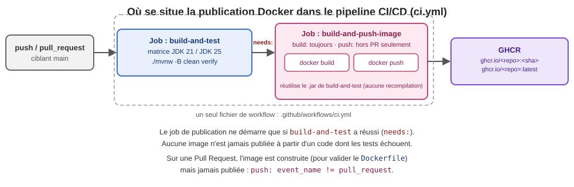

+++
title = "Registres de conteneurs et publication automatisée (CI/CD)"
weight = 3
draft = false
+++

Une image construite seulement sur votre machine ne sert à personne d'autre. Un **registre de
conteneurs** est un serveur qui héberge des images Docker, pour les partager, les versionner et les
télécharger depuis n'importe quelle machine (y compris un serveur de production ou un cluster
Kubernetes, vu plus tard dans le cours).

---

## 1️⃣ Le cycle complet : Build → Push → Pull → Run

Le registre s'insère entre deux moments distincts du cycle de vie d'une image : sa **construction**
(vue à la page précédente) et son **exécution** ailleurs que sur la machine qui l'a construite.

| Étape | Commande | Où |
|---|---|---|
| **Build** | `docker build -t mon-image:1.0 .` | Sur la machine qui construit (ex. un runner GitHub Actions) |
| **Push** | `docker push ghcr.io/.../mon-image:1.0` | Envoie l'image **vers** le registre |
| **Pull** | `docker pull ghcr.io/.../mon-image:1.0` | Récupère l'image **depuis** le registre, sur n'importe quelle autre machine |
| **Run** | `docker run -d -p 9966:9966 ghcr.io/.../mon-image:1.0` | Démarre un conteneur à partir de l'image récupérée, en arrière-plan (`-d`) |

> 💡 Le `pull` garantit que la machine qui exécute l'image obtient **exactement** le même contenu
> binaire que celui produit par le `build` — aucune reconstruction locale, donc aucun risque qu'un
> détail d'environnement diffère entre la machine de construction et celle d'exécution.

---

## 2️⃣ Deux types de registres

| Registre | Particularité |
|---|---|
| **Docker Hub** | Le registre public historique et le plus connu, indépendant de toute plateforme de code source. Compte gratuit limité en images privées, largement utilisé pour des images **publiques** de référence (ex. `eclipse-temurin`, `postgres`, `nginx` — toutes les images de base utilisées jusqu'ici proviennent de Docker Hub) |
| **GitHub Container Registry (GHCR)** | Un registre **intégré directement à GitHub**, lié à votre compte ou organisation. Chaque dépôt peut publier ses propres images, avec les mêmes permissions et la même authentification (`GITHUB_TOKEN`) que le reste de votre pipeline CI |

> 💡 Vous utilisez déjà Docker Hub **sans le savoir** : chaque fois qu'un `Dockerfile` commence par
> `FROM eclipse-temurin:21-jre-alpine`, Docker télécharge cette image depuis Docker Hub par défaut
> (aucune configuration additionnelle nécessaire pour un simple `docker pull`/`docker build` à
> partir d'une image **publique**).

### Pourquoi GHCR pour *vos* images, dans ce cours

Publier vos propres images sur GHCR plutôt que sur Docker Hub évite de gérer un compte et des
identifiants séparés : l'authentification réutilise directement `secrets.GITHUB_TOKEN`, déjà
disponible automatiquement dans tout workflow GitHub Actions (le même jeton que vous avez utilisé
pour publier des artefacts à la semaine 5). C'est le registre que vous utiliserez pour publier les
images construites par votre pipeline CI/CD.

<details>
<summary>🤔 Testez-vous</summary>

Une image `FROM postgres:16` fonctionne sans configuration de compte ou de jeton d'accès, mais
publier votre propre image sur GHCR exige une authentification (`docker login`). Pourquoi cette
différence ?

**Réponse** : télécharger (`pull`) une image **publique** ne nécessite aucune authentification —
n'importe qui peut récupérer `postgres:16` depuis Docker Hub. Publier (`push`) une image, même
publique, exige en revanche de prouver que vous avez le droit d'écrire dans ce dépôt d'images
précis (votre compte, votre organisation, votre dépôt GitHub) — d'où la nécessité d'un jeton
d'authentification au moment de la publication.
</details>

---

### Autres registres populaires

Selon la plateforme cloud utilisée, d'autres registres intégrés existent (hors de la portée du
cours, mais utile de savoir qu'ils existent) :

| Registre | Intégré à |
|---|---|
| Amazon Elastic Container Registry (ECR) | AWS |
| Google Artifact Registry | Google Cloud |
| Azure Container Registry (ACR) | Microsoft Azure |

---

## 3️⃣ Construire et pousser une image manuellement (pour comprendre le mécanisme)

Avant d'automatiser quoi que ce soit, voici les commandes équivalentes exécutées à la main, pour
bien comprendre ce que le pipeline fera ensuite automatiquement :

```bash
# 1. Construire l'image avec un nom qui inclut le registre de destination
docker build -t ghcr.io/<votre-compte-ou-organisation>/<nom-du-depot>:latest .

# 2. S'authentifier auprès de GHCR (un Personal Access Token suffit, en local)
echo $CR_PAT | docker login ghcr.io -u <votre-nom-utilisateur> --password-stdin

# 3. Publier l'image
docker push ghcr.io/<votre-compte-ou-organisation>/<nom-du-depot>:latest
```

> 💡 Le nom complet d'une image destinée à un registre suit toujours le format
> `<registre>/<compte-ou-organisation>/<nom-de-l'image>:<tag>` — c'est ce préfixe (`ghcr.io/...`)
> qui indique à Docker **où** pousser l'image lors du `docker push`.

### Et avec Docker Hub ?

Le mécanisme est identique, seul le registre cible change (et Docker Hub n'exige pas de préfixe
`docker.io/` explicite, puisque c'est le registre par défaut) :

```bash
docker build -t <votre-nom-utilisateur>/<nom-de-l'image>:latest .
docker login -u <votre-nom-utilisateur>   # demande un mot de passe ou un token interactivement
docker push <votre-nom-utilisateur>/<nom-de-l'image>:latest
```

---

## 4️⃣ Automatiser la publication dans le pipeline GitHub Actions

> 💡 **Où est le `Dockerfile` dans tout ça ?** Les workflows ci-dessous ne recopient jamais le
> contenu d'un `Dockerfile` — ils l'utilisent implicitement. `docker/build-push-action@v6` avec
> `context: .` fonctionne exactement comme `docker build .` en ligne de commande : il s'attend à
> trouver un fichier nommé `Dockerfile` à la racine de ce contexte. Ce `Dockerfile` (l'Option A vue
> à la page précédente, [Docker]({})) doit déjà exister, versionné
> dans le dépôt — le pipeline ne le génère **jamais**, il se contente de l'exécuter.

Deux façons valables d'organiser ce job dans votre pipeline, selon que vous privilégiez la
simplicité ou la réutilisation stricte de la matrice de tests JDK 21/25 (semaine 5) :



### Structure A — Job unique (compile, construit et publie dans la même session)

La plus simple : un seul job compile le projet (une seule fois, sans matrice), puis construit et
publie immédiatement l'image, en utilisant un `Dockerfile` « exécution seulement » (Option A, voir
[Docker]({})) — le `.jar` est déjà présent sur le disque du runner,
aucun transfert d'artefact n'est nécessaire entre jobs :

```yaml
# .github/workflows/ci.yml (job autonome, séparé du job de tests en matrice)
name: Build and Push Docker Image

on:
  push:
    branches: [ main ]
  pull_request:
    branches: [ main ]

jobs:
  build-and-push:
    runs-on: ubuntu-latest
    permissions:
      contents: read
      packages: write

    steps:
      - name: Checkout repository
        uses: actions/checkout@v5

      - name: Set up JDK 21
        uses: actions/setup-java@v5
        with:
          java-version: '21'
          distribution: 'temurin'
          cache: maven

      - name: Build with Maven
        run: ./mvnw -B package -DskipTests

      - name: Log in to GHCR
        if: github.event_name != 'pull_request'
        uses: docker/login-action@v3
        with:
          registry: ghcr.io
          username: ${{ github.actor }}
          password: ${{ secrets.GITHUB_TOKEN }}

      - name: Set up Docker Buildx
        uses: docker/setup-buildx-action@v3

      - name: Convertir le nom du compte/organisation en minuscules
        run: echo "OWNER_LC=${GITHUB_REPOSITORY_OWNER,,}" >> "$GITHUB_ENV"

      - name: Build and push Docker image
        uses: docker/build-push-action@v6
        with:
          context: .
          push: ${{ github.event_name != 'pull_request' }}
          tags: |
            ghcr.io/${{ env.OWNER_LC }}/petclinic:latest
            ghcr.io/${{ env.OWNER_LC }}/petclinic:${{ github.sha }}
```

| Élément | Rôle |
|---|---|
| `-DskipTests` | Les tests ont déjà été exécutés par le job de tests en matrice (semaine 5) — ce `mvn package` ne sert qu'à produire le `.jar` nécessaire à l'image, pas à revalider le code |
| `docker/setup-buildx-action@v3` | Active **Buildx**, le moteur de construction avancé de Docker (nécessaire pour le cache et certaines fonctionnalités de `build-push-action`) |
| `${GITHUB_REPOSITORY_OWNER,,}` | Syntaxe `bash` qui convertit la chaîne en minuscules — nécessaire car `${{ github.repository_owner }}` reprend la casse exacte du compte/organisation (ex. `MonOrg`), alors que Docker **exige** un nom de dépôt entièrement en minuscules |
| `petclinic` (nom fixe) | Plutôt que de réutiliser `${{ github.repository }}` (qui inclut le nom exact, parfois long, du dépôt), on choisit ici un nom d'image **fixe et court** |
| `push: ${{ github.event_name != 'pull_request' }}` | **Construit toujours** l'image (même sur une Pull Request, pour valider que le `Dockerfile` fonctionne), mais ne la **publie** que hors PR — une PR ne doit jamais publier d'image |
| `if: github.event_name != 'pull_request'` (login) | Inutile de s'authentifier sur GHCR si l'étape suivante ne va de toute façon pas publier |

> ⚠️ Cette structure compile le projet une deuxième fois (JDK 21 seulement, sans la matrice) — un
> compromis assumé : le but n'est pas de revalider la compatibilité (déjà fait par la matrice), mais
> de produire l'artefact **officiel** sur la version de JDK choisie pour la production.

### Structure B — Jobs séparés (réutilise le `.jar` du job de tests, zéro recompilation)

Pour éliminer complètement toute recompilation, un second job dédié peut dépendre du job de tests
en matrice et récupérer le `.jar` qu'il a déjà publié en artefact (semaine 5) :

```yaml
# .github/workflows/ci.yml (extrait — job ajouté après build-and-test)
jobs:
  build-and-test:
    # ... (job existant de la semaine 5, matrice JDK 21/25, inchangé —
    #      publie déjà target/*.jar en artefact pour la version JDK 21)

  build-and-push-image:
    needs: build-and-test
    if: always() && needs.build-and-test.result == 'success'
    runs-on: ubuntu-latest
    permissions:
      contents: read
      packages: write

    steps:
      - uses: actions/checkout@v5

      - name: Récupérer le .jar déjà construit (aucune recompilation ici)
        uses: actions/download-artifact@v5
        with:
          name: application-jar
          path: target/

      - name: Log in to GHCR
        if: github.event_name != 'pull_request'
        uses: docker/login-action@v3
        with:
          registry: ghcr.io
          username: ${{ github.actor }}
          password: ${{ secrets.GITHUB_TOKEN }}

      - name: Set up Docker Buildx
        uses: docker/setup-buildx-action@v3

      - name: Convertir le nom du compte/organisation en minuscules
        run: echo "OWNER_LC=${GITHUB_REPOSITORY_OWNER,,}" >> "$GITHUB_ENV"

      - name: Build and push Docker image
        uses: docker/build-push-action@v6
        with:
          context: .
          push: ${{ github.event_name != 'pull_request' }}
          tags: |
            ghcr.io/${{ env.OWNER_LC }}/petclinic:latest
            ghcr.io/${{ env.OWNER_LC }}/petclinic:${{ github.sha }}
```

| Élément | Rôle |
|---|---|
| `actions/download-artifact@v5` | Récupère le `.jar` publié par `build-and-test` — aucun second `mvn package` n'est nécessaire |
| `needs: build-and-test` | Garantit que l'image n'est jamais publiée si la suite de tests a échoué |

### Quelle structure choisir ?

| Critère | Structure A (job unique) | Structure B (jobs séparés) |
|---|---|---|
| Simplicité | ✅ Un seul job, plus facile à lire | Deux jobs à maintenir |
| Zéro recompilation | ❌ Recompile une fois (JDK 21 seulement) | ✅ Réutilise le `.jar` existant |
| Dépendance à la matrice de tests | Aucune — autonome | Dépend explicitement de `build-and-test` |

> 💡 Peu importe la structure choisie, l'important est la règle commune : **construire** l'image
> peut se faire à chaque Pull Request (pour valider le `Dockerfile`), mais **publier** sur GHCR ne
> doit jamais se produire avant la fusion sur `main`.

Les éléments communs aux deux structures :

| Élément | Rôle |
|---|---|
| `docker/build-push-action@v6` | Action officielle qui construit **et** publie l'image en une seule étape, sans commandes `docker build`/`docker push` manuelles |
| `${{ env.OWNER_LC }}` | Le compte/organisation GitHub, converti en minuscules — Docker **exige** un nom de dépôt entièrement en minuscules, alors que `${{ github.repository_owner }}` reprend la casse exacte configurée sur GitHub |
| `${{ github.sha }}` | Le SHA complet du commit courant — un tag **unique et traçable** pour chaque image publiée |

> ⚠️ `secrets.GITHUB_TOKEN` est généré **automatiquement** par GitHub pour chaque exécution de
> workflow — vous n'avez rien à configurer manuellement dans les secrets du dépôt pour publier sur
> GHCR (contrairement à un Personal Access Token, nécessaire seulement pour une publication
> **manuelle** depuis votre poste, comme à la section précédente).

> ⚠️ **Cas particulier** : `GITHUB_TOKEN` ne peut publier que dans le namespace GHCR **du
> propriétaire du dépôt** (votre compte ou votre organisation). Si votre workflow pousse
> explicitement vers un **autre** compte/namespace (ex. `ghcr.io/un-autre-compte/image`, un cas qui
> arrive si le dépôt appartient à une organisation mais que vous publiez sous votre compte
> personnel), `GITHUB_TOKEN` échoue avec `denied: denied` même si `permissions: packages: write`
> est bien présent — ce n'est pas un problème de permission du workflow, mais une limite
> d'autorisation **du compte cible**. Il faut alors revenir à un Personal Access Token (classique,
> scope `write:packages`) appartenant à ce compte cible, passé comme secret du dépôt.

---

## 📚 Références

- Documentation officielle GitHub — [Working with the Container registry](https://docs.github.com/packages/working-with-a-github-packages-registry/working-with-the-container-registry).
- Action officielle — [docker/build-push-action](https://github.com/docker/build-push-action).
- Action officielle — [docker/login-action](https://github.com/docker/login-action).
- Documentation officielle Docker Hub — [docs.docker.com/docker-hub](https://docs.docker.com/docker-hub/).

{}
Poursuivez avec l'[exercice Registre de conteneurs]({})
pour publier réellement une image depuis votre propre pipeline CI. Pour voir comment un tag Git
déclenche aussi la création automatique d'une Release GitHub, consultez
[Tags Git et publications (Releases) GitHub]({}) à la semaine 8.
{}
